<!-- readme-atelier:start -->
<!-- Generated by Readme Atelier (https://github.com/monokernn/readme-atelier). Edit atelier.yml instead of this block. -->

<picture><source media="(prefers-color-scheme: dark)" srcset="./atelier/header-dark.018b82e0.svg"/></picture>

  <a href="https://github.com/lucifer-grokbot"><picture><source media="(prefers-color-scheme: dark)" srcset="./atelier/social-github-dark.689b2648.svg"/></picture></a>&nbsp;
  <a href="https://clawbackshield.netlify.app"><picture><source media="(prefers-color-scheme: dark)" srcset="./atelier/social-website-dark.449241a6.svg"/></picture></a>

  <picture><source media="(prefers-color-scheme: dark)" srcset="./atelier/stats-dark.94b07d50.svg"/></picture>
  <picture><source media="(prefers-color-scheme: dark)" srcset="./atelier/languages-dark.9daf3a5d.svg"/></picture>

<picture><source media="(prefers-color-scheme: dark)" srcset="./atelier/activity-dark.282f29f8.svg"/></picture>

  <a href="https://github.com/lucifer-grokbot/clawbackshield"><picture><source media="(prefers-color-scheme: dark)" srcset="./atelier/repo-1-dark.6b8074c7.svg"/></picture></a>

<picture><source media="(prefers-color-scheme: dark)" srcset="./atelier/stack-dark.130072db.svg"/></picture>

<picture><source media="(prefers-color-scheme: dark)" srcset="./atelier/footer-dark.eecba273.svg"/></picture>

<!-- readme-atelier:end -->
